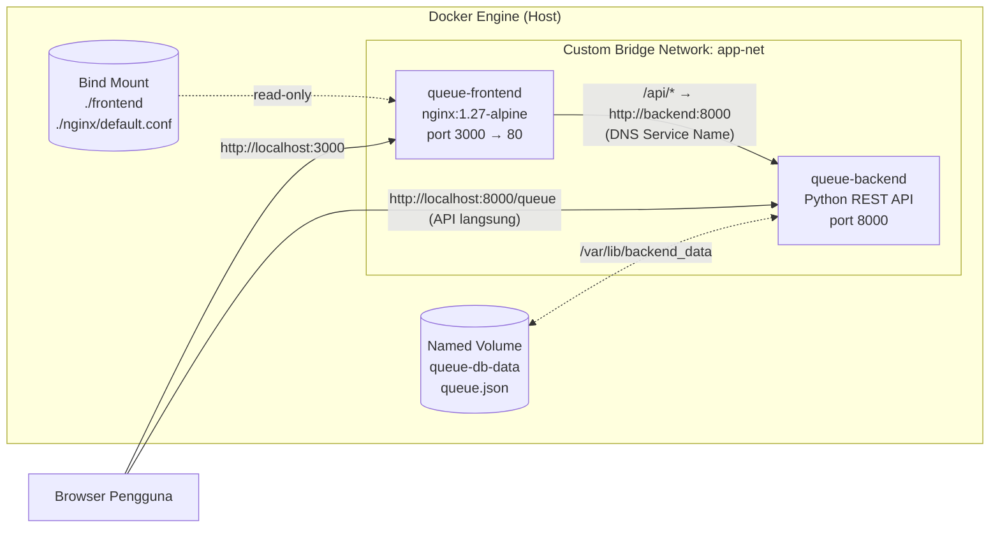
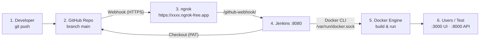

# Antrean Layanan Mahasiswa — Student Service Queue System

> **UTS Cloud Computing (Ujian Chunin)** — Cloud-Native Fullstack Application & Automated CI/CD Pipeline
> **Studi Kasus 3:** Antrean Layanan Mahasiswa (Student Service Queue System)

Aplikasi nomor antrean sederhana untuk layanan administrasi kampus (LAA). Mahasiswa mengambil nomor antrean,
petugas loket memanggil antrean terdepan, dan seluruh data tersimpan di **Docker Named Volume** sehingga tetap aman
walaupun kontainer dihapus. Setiap `git push` ke branch `main` otomatis di-build dan di-deploy oleh **Jenkins** melalui
**GitHub Webhook** (diekspos ke internet memakai **ngrok**).

## Anggota Kelompok

| No | Nama | NIM |
|----|------|-----|
| 1  | Fakhri Muhammad Al Hisyam | 101012300055 |
| 2  | Hatta Dwi Putranto | 101012330137 |
| 3  | Alifia Anjelita | 101012330149 |
| 4  | Edric Wijaya | 101012400375 |

---

## 1. Fitur & Teknologi

| Komponen | Teknologi | Keterangan |
|----------|-----------|------------|
| Backend  | Python 3.12 `http.server` (tanpa framework) | REST API JSON: `GET/POST/DELETE /queue`, `GET /health` |
| Frontend | HTML + CSS + Vanilla JS (`fetch()`) di **Nginx** | Ambil nomor, panggil antrean, hapus antrean, auto-refresh 3 detik |
| Storage  | **Named Volume** `queue-db-data` → `/var/lib/backend_data/queue.json` | Data bertahan walau `docker rm -f` |
| UI files | **Bind Mount** `./frontend` → `/usr/share/nginx/html` | Edit `index.html` langsung terlihat tanpa rebuild |
| Network  | **Custom Bridge Network** `app-net` | Frontend memanggil backend via Service Name `backend` (DNS Docker) |
| Orkestrasi | `docker-compose.yml` | Seluruh stack deklaratif |
| CI/CD    | Jenkins Declarative Pipeline + GitHub Webhook + ngrok | 5 stage: Checkout → Syntax Check → Build Image → Automated Deployment → Health Check |

## 2. Struktur Repositori

```
uts-antrean-layanan/
├── backend/
│   ├── app.py               # REST API (Python standard library saja)
│   ├── Dockerfile           # image backend + HEALTHCHECK
│   └── tests/test_app.py    # unit test (dijalankan di stage Syntax Check)
├── frontend/
│   └── index.html           # UI (HTML + Vanilla JS), di-bind mount ke Nginx
├── nginx/
│   └── default.conf         # Nginx: sajikan UI + reverse proxy /api -> backend:8000
├── jenkins/
│   ├── Dockerfile           # Jenkins LTS + Docker CLI + Compose + Python3
│   └── docker-compose.yml   # menjalankan Jenkins (+ ngrok opsional)
├── scripts/
│   └── data-immunity-test.ps1  # simulasi Data Immunity untuk video demo
├── docker-compose.yml       # stack aplikasi (backend, frontend, app-net, queue-db-data)
├── Jenkinsfile              # pipeline CI/CD 5 stage
└── README.md
```

## 3. Diagram Arsitektur

### 3.1 Arsitektur Docker (runtime)



Versi teks (jika Mermaid tidak tampil):

```
                 ┌──────────────────────── Docker Host ────────────────────────────┐
                 │   ┌──────────── Custom Bridge Network: app-net ─────────────┐   │
 Browser ──:3000─┼──►│ queue-frontend (Nginx)   ──/api──►  queue-backend (Py) │◄──┼──:8000── curl/Postman
                 │   │   ▲  http://backend:8000 (DNS)          ▲              │   │
                 │   └───┼─────────────────────────────────────┼──────────────┘   │
                 │       │ Bind Mount                          │ Named Volume     │
                 │  ./frontend/index.html               queue-db-data            │
                 │  ./nginx/default.conf                 └─ queue.json           │
                 └─────────────────────────────────────────────────────────────────┘
```

### 3.2 Arsitektur CI/CD



Alur pipeline (`Jenkinsfile`):

| Stage | Isi |
|-------|-----|
| 1. Checkout | `checkout scm` memakai credential PAT `github-pat` |
| 2. Syntax Check | `py_compile app.py`, unit test API, `docker compose config`, cek `index.html` |
| 3. Build Image | `docker compose build backend` → tag `queue-backend:<BUILD_NUMBER>` & `latest` |
| 4. Automated Deployment | `docker compose down` (stop kontainer lama, **volume tidak dihapus**) → `docker compose up -d` |
| 5. Health Check | tunggu status `healthy`, cek `/health`, cek frontend → backend via DNS, cek UI dari bind mount |

## 4. Dokumentasi API

Base URL: `http://localhost:8000` (langsung) atau `http://localhost:3000/api` (lewat Nginx).

| Method | Endpoint | Keterangan | Sukses |
|--------|----------|------------|--------|
| GET | `/queue` | Daftar antrean + antrean terakhir dipanggil | 200 |
| POST | `/queue` | Ambil nomor antrean. Body: `{"name": "Budi", "nim": "1301220001", "service": "akademik"}` | 201 |
| DELETE | `/queue?index=0` | Panggil/selesaikan antrean pada index X (index 0 = terdepan) | 200 |
| GET | `/health` | Health check (Docker HEALTHCHECK & Jenkins) | 200 |

Nilai `service`: `akademik` (A), `keuangan` (K), `kemahasiswaan` (M), `umum` (U) → menjadi prefix tiket, contoh `A001`, `K002`.

**Error handling:**

| Kode | Kondisi |
|------|---------|
| 400 | JSON tidak valid, body kosong / bukan object, `name` kosong, `nim` bukan angka, `service` tidak dikenal, `index` tidak ada / bukan angka / negatif |
| 404 | Endpoint tidak ada, atau `index` di luar jumlah antrean |
| 405 | Method tidak diizinkan (mis. `POST /health`) |
| 413 | Body lebih dari 10 KB |

Format error: `{"status": "error", "code": 404, "message": "Antrean pada index 5 tidak ditemukan (jumlah antrean: 1)"}`

Contoh (PowerShell / Git Bash):

```bash
curl http://localhost:8000/queue
curl -X POST http://localhost:8000/queue -H "Content-Type: application/json" \
     -d '{"name":"Budi Santoso","nim":"1301220001","service":"akademik"}'
curl -X DELETE "http://localhost:8000/queue?index=0"
curl http://localhost:8000/health
```

## 5. Instalasi & Menjalankan Secara Lokal

**Prasyarat:** Docker Desktop (Compose v2), Git.

```bash
git clone https://github.com/<username>/<repo>.git
cd <repo>
docker compose up -d --build
docker compose ps
```

| Layanan | URL |
|---------|-----|
| Frontend (UI) | http://localhost:3000 |
| Backend API | http://localhost:8000/queue |
| Health | http://localhost:8000/health |

Cek resource Docker yang dibuat:

```bash
docker network inspect app-net        # frontend & backend di network yang sama
docker volume inspect queue-db-data   # named volume data antrean
docker inspect queue-frontend --format "{{json .Mounts}}"   # bind mount frontend
```

Menjalankan unit test backend tanpa Docker: `python -m unittest discover -s backend/tests -v`

### 5.1 Uji Data Immunity (Named Volume)

```powershell
powershell -ExecutionPolicy Bypass -File scripts\data-immunity-test.ps1
```

Atau manual:

```bash
curl -X POST http://localhost:8000/queue -H "Content-Type: application/json" -d '{"name":"Tes Volume"}'
docker rm -f queue-backend          # hancurkan kontainer
docker compose up -d backend        # buat ulang
curl http://localhost:8000/queue    # data "Tes Volume" masih ada
```

> Data hanya hilang jika volume dihapus secara eksplisit: `docker compose down -v` (gunakan untuk reset data).

### 5.2 Uji Bind Mount

Ubah teks di `frontend/index.html` (mis. judul `<h1>`), simpan, lalu refresh browser — perubahan langsung terlihat
**tanpa** `docker compose build`.

## 6. Setup Jenkins CI/CD

### 6.1 Jalankan Jenkins

Jenkins dijalankan di Docker dengan akses ke Docker Engine host (`/var/run/docker.sock`).

```bash
cd jenkins
cp .env.example .env      # isi JENKINS_ADMIN_PASSWORD & APP_REPO_URL (file .env tidak di-commit)
docker compose up -d --build
```

Saat start, skrip di `jenkins/init.groovy.d/` otomatis:
- `01-security.groovy` → membuat user admin dari `.env` dan melewati setup wizard
- `02-pipeline-job.groovy` → membuat job **`queue-system-pipeline`** (Pipeline script from SCM, repo `APP_REPO_URL`,
  credential `github-pat`, branch `*/main`, Script Path `Jenkinsfile`, trigger *GitHub hook trigger for GITScm polling*)

Buka http://localhost:8080 (atau port `JENKINS_PORT`) → login admin → job sudah tersedia → klik **Build Now** sekali.
Plugin `git`, `github`, `workflow-aggregator`, `timestamper` sudah ter-install dari `jenkins/Dockerfile`.
Langkah manual pada 6.4 hanya diperlukan jika `APP_REPO_URL` dikosongkan.

> **Kenapa `/var/jenkins_home:/var/jenkins_home`?** Jenkins memanggil Docker Engine host. Bind mount `./frontend` di
> `docker-compose.yml` di-resolve oleh Engine sebagai `/var/jenkins_home/workspace/<job>/frontend`. Dengan path host = path
> kontainer, folder tersebut benar-benar ada, sehingga bind mount tetap berfungsi saat deploy dari Jenkins.
>
> Jika port 8080 sudah terpakai: `JENKINS_PORT=8090 docker compose up -d` (PowerShell: `$env:JENKINS_PORT="8090"; docker compose up -d`).

### 6.2 Buat GitHub Personal Access Token (PAT)

1. GitHub → foto profil → **Settings** → **Developer settings**.
2. **Personal access tokens** → **Tokens (classic)** → **Generate new token (classic)**.
3. Note: `Jenkins CI/CD UTS Token`, Expiration: 30/90 days.
4. Centang scope **`repo`** dan **`admin:repo_hook`**.
5. **Generate token** → salin token `ghp_xxxx...` (hanya tampil sekali).

### 6.3 Tambahkan Credential di Jenkins

**Manage Jenkins → Credentials → System → Global credentials → Add Credentials**

| Field | Isi |
|-------|-----|
| Kind | Username with password |
| Username | username GitHub |
| Password | token PAT `ghp_xxxx...` |
| ID | `github-pat` |

### 6.4 Buat Pipeline Job

1. **New Item** → nama `queue-system-pipeline` → **Pipeline** → OK.
2. **General** → centang **GitHub project** → URL repo `https://github.com/<username>/<repo>/`.
3. **Triggers** → centang **GitHub hook trigger for GITScm polling**.
4. **Pipeline** → Definition **Pipeline script from SCM** → SCM **Git**
   - Repository URL: `https://github.com/<username>/<repo>.git`
   - Credentials: `github-pat`
   - Branch Specifier: `*/main`
   - Script Path: `Jenkinsfile`
5. **Save** → klik **Build Now** sekali (build pertama juga mendaftarkan trigger `githubPush()`).

### 6.5 Ekspos Jenkins dengan ngrok

Daftar gratis di https://ngrok.com → ambil **Authtoken**. Pilih salah satu cara:

```bash
# Cara A: ngrok terinstal di Windows
ngrok config add-authtoken <TOKEN>
ngrok http 8080

# Cara B: ngrok sebagai kontainer (dari folder jenkins/)
NGROK_AUTHTOKEN=<TOKEN> docker compose --profile tunnel up -d     # Git Bash
# PowerShell: $env:NGROK_AUTHTOKEN="<TOKEN>"; docker compose --profile tunnel up -d
# Lihat URL publik di http://localhost:4040
```

Catat URL publik, contoh `https://abcd-1234.ngrok-free.app`.

### 6.6 Pasang GitHub Webhook

Repo GitHub → **Settings → Webhooks → Add webhook**

| Field | Isi |
|-------|-----|
| Payload URL | `https://abcd-1234.ngrok-free.app/github-webhook/` (wajib diakhiri `/`) |
| Content type | `application/json` |
| Events | Just the push event |
| Active | ✔ |

Setelah disimpan, tab **Recent Deliveries** harus menunjukkan respon **200**.

> URL ngrok gratis berubah setiap ngrok di-restart → perbarui Payload URL webhook.

### 6.7 Uji Auto-Deploy

```bash
# ubah sesuatu, contoh judul di frontend/index.html atau pesan di backend/app.py
git add .
git commit -m "feat: ubah judul halaman antrean"
git push origin main
```

Jenkins otomatis menjalankan build baru (*Started by GitHub push by ...*), seluruh 5 stage hijau, dan perubahan langsung
terlihat di http://localhost:3000.

## 7. Skenario Video Demo (5–8 menit)

| Menit | Konten |
|-------|--------|
| 0:00–0:45 | Perkenalan anggota, studi kasus 3, tunjukkan diagram arsitektur di README |
| 0:45–2:00 | Tunjukkan struktur repo: `app.py`, `index.html`, `Dockerfile`, `docker-compose.yml`, `Jenkinsfile` |
| 2:00–3:30 | Demo UI: ambil nomor, panggil antrean, hapus antrean (real-time). Demo API via curl + contoh error 400/404 |
| 3:30–4:45 | **Data Immunity**: jalankan `scripts\data-immunity-test.ps1` (`docker rm -f queue-backend` → data tetap ada) |
| 4:45–5:15 | **Bind Mount**: edit `index.html`, refresh browser tanpa rebuild |
| 5:15–7:30 | **CI/CD**: ubah kode → `git push` → GitHub webhook (Recent Deliveries 200) → Jenkins ter-trigger otomatis → 5 stage hijau → perubahan tampil di browser |
| 7:30–8:00 | Penutup |

## 8. Pemetaan Rubrik

| Komponen Rubrik | Bukti di Proyek |
|-----------------|-----------------|
| Backend Python API (20%) | `backend/app.py`: GET/POST/DELETE + `/health`, respon JSON konsisten, error 400/404/405/413, unit test |
| Frontend HTML & JS (15%) | `frontend/index.html`: `fetch()` async, tombol Panggil/Hapus real-time, auto-refresh, status API |
| Docker & Storage (25%) | Named Volume `queue-db-data` untuk data, Bind Mount untuk UI, network `app-net`, `scripts/data-immunity-test.ps1` |
| Jenkins CI/CD (25%) | `Jenkinsfile` 5 stage + `githubPush()` + webhook via ngrok |
| Dokumentasi & Demo (15%) | README ini (diagram, langkah lokal & Jenkins, skenario video) |

## 9. Troubleshooting

| Masalah | Solusi |
|---------|--------|
| `port is already allocated` | Port 3000/8000/8080 dipakai aplikasi lain → hentikan aplikasi itu atau ubah mapping port |
| UI menampilkan "API tidak tersedia" | `docker compose ps` → pastikan `queue-backend` *healthy*; cek `docker logs queue-backend` |
| Frontend 403 Forbidden | Folder sumber bind mount tidak ada → jalankan `docker compose up -d` dari root repo |
| Webhook GitHub gagal (bukan 200) | Pastikan ngrok aktif, URL terbaru, dan diakhiri `/github-webhook/` |
| Jenkins tidak ter-trigger | Pastikan opsi *GitHub hook trigger for GITScm polling* aktif & sudah pernah **Build Now** sekali |
| `docker: not found` di Jenkins | Jalankan Jenkins dari `jenkins/docker-compose.yml` (image sudah berisi Docker CLI) |
| Reset seluruh data | `docker compose down -v` (menghapus volume `queue-db-data`) |
